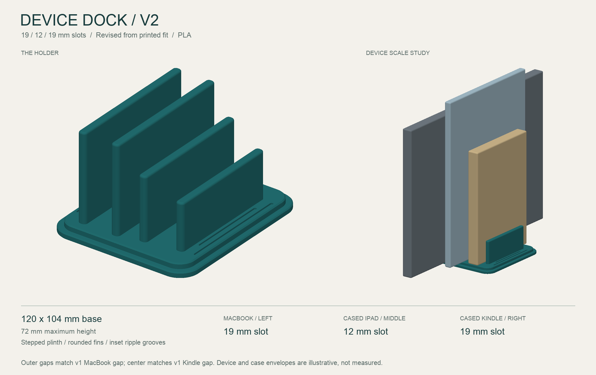

# Device Dock — v2

A compact three-slot vertical holder for a closed MacBook Pro 14, an iPad Pro 11 with a case, and a Kindle Paperwhite with a case. The two outside openings are 19 mm wide; the center opening is 12 mm wide.



## Fit correction from the first print

The original design printed successfully, but the iPad and Kindle are normally stored in cases. The owner confirmed that the original 19 mm MacBook slot fits the cased Kindle, and the original 12 mm Kindle slot fits the cased iPad. This revision reuses those tested openings instead of estimating case thicknesses.

| Position, viewed from the open end with the tallest fins on the left | Device | Opening |
| --- | --- | --- |
| Left | MacBook Pro 14 | 19 mm |
| Middle | iPad Pro 11 with case | 12 mm |
| Right | Kindle Paperwhite with case | 19 mm |

The v1 slot order was **19 / 9 / 12 mm**. The v2 order is **19 / 12 / 19 mm**. Case thicknesses have not been measured, so exact remaining clearance is unspecified. These openings already include the space the owner found usable in the first print; no extra clearance is added in v2.

## Shape and dimensions

| Feature | Dimension (mm) |
| --- | --- |
| Base, along devices × across slots | 120 × 104 |
| Maximum overall height | 72 |
| Slot floor above desk | 8 |
| Wall thickness | 6 |
| Wall heights above floor, left to right | 64 / 64 / 46 / 34 |
| Wall lengths, left to right | 100 / 100 / 92 / 84 |
| Combined span of four walls and three openings | 74 |

The rounded, two-level base, wall heights, and wall lengths are retained from v1. The walls move outward to accommodate the wider slots. The decorative ripple grooves move outward too, keeping them clear of the widened fin layout. Rounded crowns guide insertion and open slot ends let the devices extend beyond the holder.

The preview includes illustrative device/case envelopes; it does not encode actual case measurements, ports, buttons, cameras, or feet. Place the laptop on its long edge and center all devices along the base.

## Current files

- [device_dock_v2.step](device_dock_v2.step): editable CAD solid for this revision.
- [device_dock_v2.stl](device_dock_v2.stl): full-holder print mesh.
- [fit_coupon_v2.stl](fit_coupon_v2.stl): 22 mm long, 26 mm tall section retaining all three slot widths.
- [design.py](design.py): editable CadQuery parameters and export/geometry validation.
- [render_preview.py](render_preview.py): software rendering and mesh validation.
- [dimensions.json](dimensions.json): dimensions, fit basis, and validation results.

[archive/v1](archive/v1/) preserves the original source, models, preview, notes, the owner's `.3mf` slicer project, and the binary G-code from the first print. Those slicer files represent v1; slice the new STL or STEP to print v2.

## Printing and checking fit

Use the setup in [PRINTER.md](../PRINTER.md). Import the new model at 100% scale in millimeters and use the MK4S profile for the installed 0.4 mm high-flow nozzle and the appropriate PLA profile.

The starting settings from v1 are 0.20 mm layers, 5 perimeters, 6 top/bottom layers, and 25% gyroid infill. Print flat base down; the geometry is intended to print without supports. Review the sliced preview and use any successful settings from the first print where appropriate.

The small fit coupon can confirm the new arrangement before a full print. Check the iPad and Kindle with their usual cases attached. Additional liners reduce the available opening and are not included in these dimensions. Check loaded stability on the intended desk, especially with the laptop alone, because the outside slot centers move 5 mm outward in v2.

## Regenerating

From the repository root, with [requirements.txt](../requirements.txt) installed:

```sh
python device-dock/design.py
python device-dock/render_preview.py
```

STEP preserves the solid geometry; the design parameters live in the Python source. Validation checks a single valid solid, the overall dimensions, clear nominal slots, and STEP round-trip volume agreement. Both STL exports are checked for a closed manifold and one connected component. Physical stability and handling still need a prototype check.
