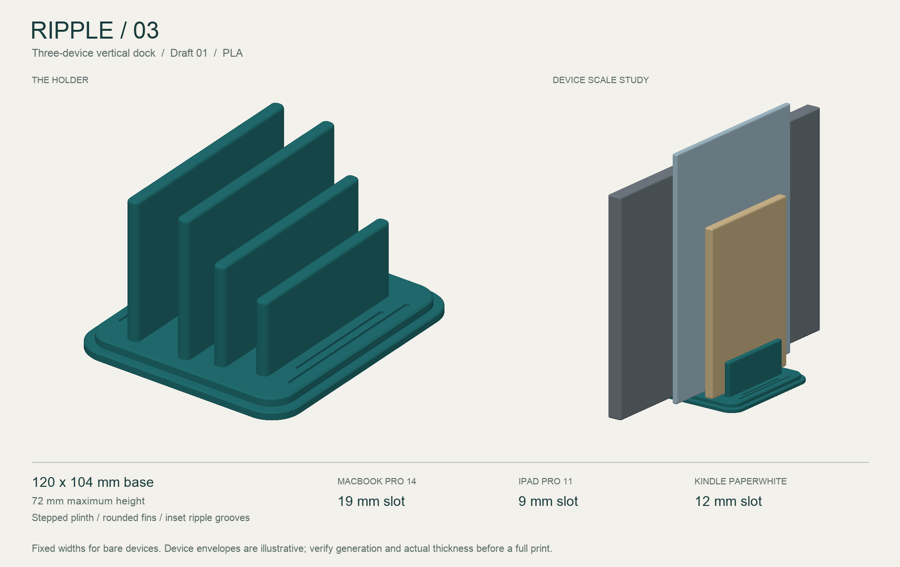

# Ripple Dock — three-device holder, draft 01

A compact, one-piece vertical storage dock for a closed 14-inch MacBook Pro, an 11-inch iPad Pro, and a Kindle Paperwhite. Three different fixed widths, sized for bare devices as requested. All dimensions are in millimeters.



## Files

- `ripple_dock_v1.step`: the requested CAD solid, ready to import into a STEP-capable CAD application or PrusaSlicer.
- `ripple_dock_v1.stl`: the same holder as a print mesh.
- `fit_coupon.stl`: a 22 mm long, 26 mm tall section of the actual holder, retaining all three slot widths. Print this first to check clearances. It only checks fit, not stability.
- `design.py`: editable CadQuery source. Change the top-level parameters and rerun to regenerate STEP, STL, and the fit coupon. STEP preserves the solid geometry; the parameters live in this script.
- `preview.png`: rendered from the exported holder mesh, with illustrative device envelopes.
- `dimensions.json`: dimensions and geometric validation results.
- `render_preview.py`: regenerates the preview and checks mesh closure.

## Dimensions and fit

| Feature | Dimension |
| --- | --- |
| Overall base, along devices × across slots | 120 × 104 |
| Slot floor above desk | 8 |
| Maximum overall height | 72 |
| Wall thickness | 6 |
| Wall heights above slot floor, MacBook side to Kindle side | 64 / 64 / 46 / 34 |
| Wall lengths, in the same order | 100 / 100 / 92 / 84 |

| Slot | Assumed bare-device thickness | CAD opening | Total free clearance |
| --- | --- | --- | --- |
| MacBook Pro 14 | 15.5 | 19 | 3.5 |
| iPad Pro 11 | 5.9 | 9 | 3.1 |
| Kindle Paperwhite | 9.2 | 12 | 2.8 |

Clearance is the total across both sides. Printed dimensions will depend on extrusion calibration and material. Openings are the straight parallel gaps below the rounded wall crowns; the crowns widen the entry locally.

Device generations have not been confirmed. The MacBook assumption uses [Apple's 14-inch 2023 specifications](https://support.apple.com/en-in/111340). The iPad allowance uses the 5.9 mm thickness of the [11-inch fourth generation](https://support.apple.com/en-la/111842); newer [11-inch models can be 5.3 mm thick](https://www.apple.com/ipad-pro/specs/). The Kindle allowance rounds up the 9.16 mm thickness in an [earlier Paperwhite user guide](https://kindle.s3.amazonaws.com/UserGuide/Paperwhite/Kindle_Paperwhite_User_Guide_enUS.pdf). These are design assumptions, not identification of the owner's devices.

Place the closed laptop on its long edge, centered along the base. The tablet and Kindle stand upright with their shorter bottom edges centered along the base. Slot ends are open, allowing the device edges to extend beyond the holder. The preview envelopes illustrate scale only and omit cameras, buttons, feet, ports, and covers. Check the chosen resting edge for protrusions when trying the coupon.

## Design details

- A rounded, two-level plinth with recessed paired “ripple” grooves creates a finished base without a large footprint.
- Four fins step down in height and length toward the Kindle. The laptop is supported on both sides by the tallest fins.
- Rounded vertical corners and wall crowns soften contact and guide insertion.
- The 120 mm base stays close to the width of a small Paperwhite instead of matching the laptop's full length.
- The broad base and tall laptop walls are intended to limit leaning. Loaded stability, wall strength, and slip resistance still need a physical prototype; height alone does not establish tip resistance.

## Prototype on the MK4S

Starting settings for the existing 0.4 mm high-flow nozzle and PLA setup:

1. Import `fit_coupon.stl` at 100% scale in millimeters. Use the installed-nozzle MK4S printer profile and a PLA profile suitable for the spool.
2. Print flat side down, with a 0.20 mm layer height, 5 perimeters, 6 top/bottom layers, and 25% gyroid infill as initial settings. The geometry is intended to print upright without supports. Review the sliced preview before printing.
3. Confirm each device enters and exits easily. Avoid pressing a tight fit into a device. Adjust `GAPS` in the source if needed.
4. Print the full holder with its flat base on the bed. Its 104 × 120 × 72 mm envelope fits within the [MK4S's 250 × 210 × 220 mm build volume](https://help.prusa3d.com/article/faq-frequently-asked-questions_1932).
5. Smooth any sharp print artifacts. Optional thin felt or silicone liners protect contact surfaces; 0.5 mm on each slot wall reduces each opening by 1 mm. Liners and adhesive rubber feet are not included in the CAD.
6. Test stability gently on the intended desk, starting with the laptop alone and then trying each loading combination. Center devices along the base and add rubber feet if it slides.

Use the printer profile's normal PLA temperatures and flow limits as a starting point; final print time and material use come from PrusaSlicer. This draft is for desk storage; measured fit and loaded handling checks should guide the next revision.

## Regeneration

Use Python 3.12 with `cadquery==2.8.0`. The preview also uses `vtk==9.6.2`, NumPy, and Pillow. VTK reads and checks the mesh; a software renderer draws it without requiring a graphics context.

```sh
python design.py
python render_preview.py
```

Keep the total wall-and-gap span comfortably inside the inset base when editing widths. The current span is 64 mm, centered within the 96 mm upper deck.

Validation checks the solid, connected component count, CAD dimensions, unobstructed nominal gaps, and STEP import/export volume agreement. The preview script also checks the exported STL for boundary and nonmanifold edges. These checks do not replace a physical fit and stability test.
