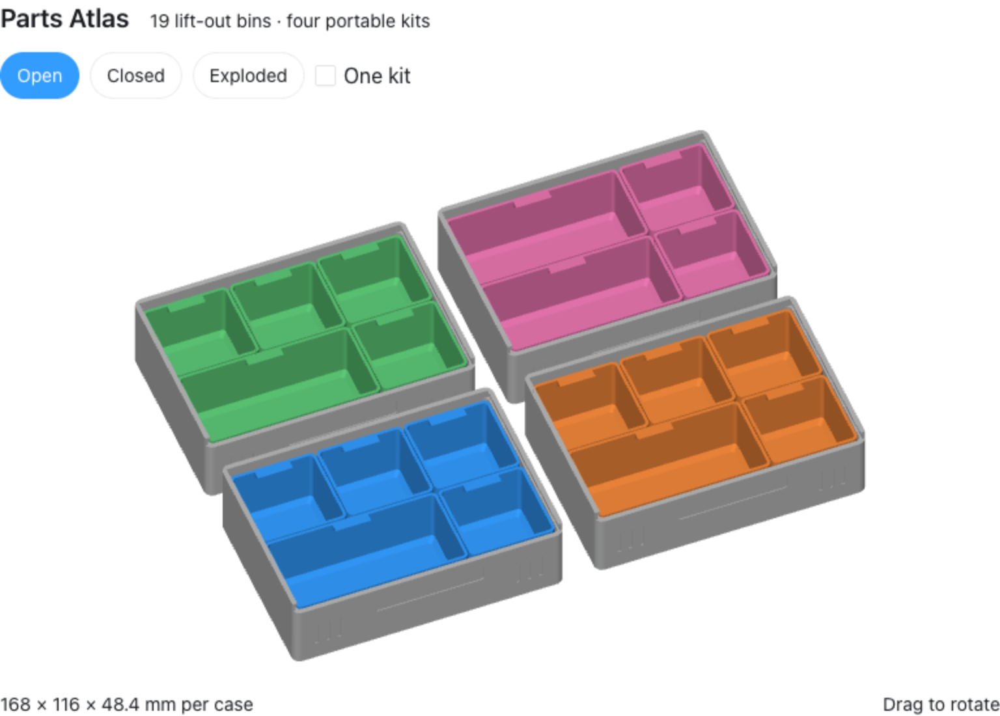

# Parts Atlas — v1 prototype

A smaller reinterpretation of a 19-bin parts organizer: four independent cases,
14 square lift-out bins, five double-width bins, and four opaque sliding lids.
Print complete parts in contrasting filament colors; no multi-material unit is
required. Cases do not mechanically connect to one another.



Each case measures **168 × 116 × 48.4 mm**. A 2 × 2 arrangement occupies
336 × 232 mm. Rounded bin interiors have a bottom scoop chamfer and inward
label/grip ledges. Lids have finger ribs, a label recess, and inset contour lines.

## Print files

| STL | Full-set quantity | Purpose |
| --- | --- | --- |
| [case.stl](case.stl) | 4 | Case with sliding-lid tracks |
| [lid.stl](lid.stl) | 4 | Opaque sliding lid |
| [bin-small.stl](bin-small.stl) | 14 | 53.2 × 53.2 × 40 mm bin |
| [bin-double.stl](bin-double.stl) | 5 | 107.2 × 53.2 × 40 mm bin |
| [fit-rail.stl](fit-rail.stl) | 1 sample | Full-width, 18 mm long rail section |
| [fit-slider.stl](fit-slider.stl) | 1 sample | Matching slider sample |

Cases A–C each hold one double bin and four small bins. Case D holds two
double bins and two small bins. See [PRINTING.txt](PRINTING.txt) for layouts,
orientations, proposed slicer settings, and the sample-fit procedure.

## Prototype status

Designed around [our Original Prusa MK4S setup](../PRINTER.md), using PLA and
the installed 0.4 mm high-flow nozzle. Every individual part fits its nominal
build volume. Print the rail and slider samples first, then one complete case.
The design is intended to print without supports; inspect the sliced preview.

This revision has passed digital geometry checks but has not been physically
printed or tested. The lid has **no positive latch**: use a snug external elastic
band or reusable strap before carrying a closed case. The 0.4 mm nominal gap
above the bins is unsealed, so very fine contents can migrate between bins.

## Source and validation

[design.py](design.py) generates the STL files, [dimensions.json](dimensions.json),
and [preview-meshes.json](preview-meshes.json). This revision uses Manifold and
Trimesh and does not include STEP solids. Use its project-specific environment:

```sh
python3.12 -m venv parts-atlas/.venv
parts-atlas/.venv/bin/python -m pip install -r parts-atlas/requirements.txt
parts-atlas/.venv/bin/python parts-atlas/design.py
```

Generation checks closed, consistently oriented meshes, one solid per source
part, STL reimport, build-volume limits, nominal bin clearances, and lid/case
clearance at five sampled slide positions. These checks do not establish print
tolerances, full swept-motion clearance, friction, spill resistance or durability.
The PNG is a design preview; no machine G-code or binary G-code is included.

Reference: [Amazon Basics 19-compartment organizer](https://www.amazon.com/dp/B08RZMKC9K).
